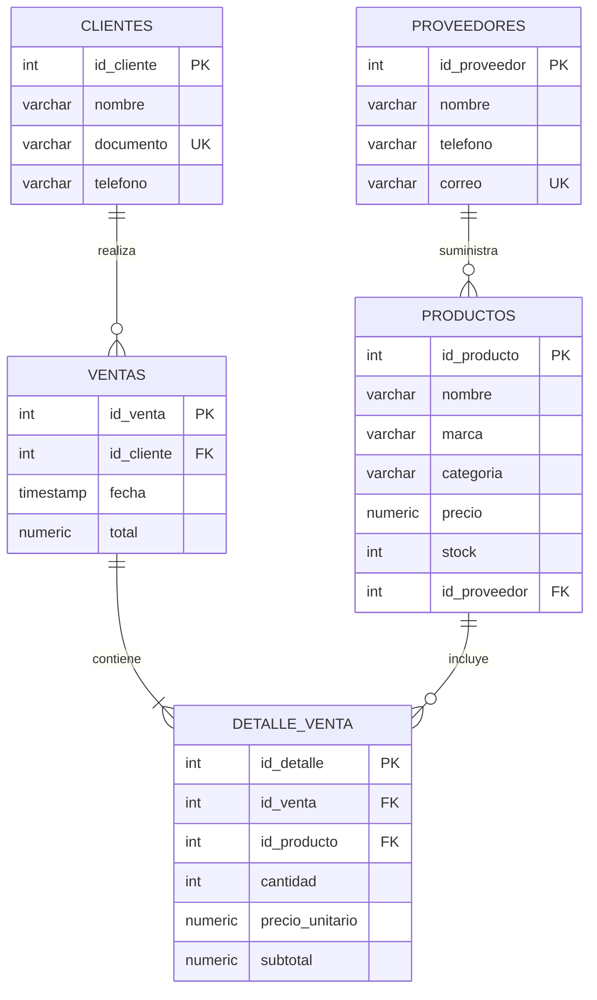

# Sistema para Venta de Computadoras

**Estudiante:** Kevin Sánchez Quispe 
**Carrera:** Ingeniería de Sistemas e Informática  
**Asignatura:** Base de Datos (nombre provisional, editable)  
**Fecha:** 27/10/2026

## Descripción

El proyecto modela la venta de computadoras y accesorios de una tienda: proveedores, productos, clientes, ventas y el detalle de cada venta. La base de datos está en PostgreSQL. Una API REST mínima, hecha con Node.js y Express, consulta esas tablas y registra ventas dentro de una transacción.

No incluye frontend, autenticación, panel administrativo ni facturación electrónica.

## Objetivo académico

Diseñar el modelo conceptual, lógico y físico de una base de datos relacional, implementarlo con SQL y comprobar sus relaciones mediante consultas y una API que mantiene consistentes el total de la venta y el stock.

## Tecnologías

- PostgreSQL
- SQL (DDL, DML y consultas)
- Node.js 18 o superior
- Express 4
- Paquete `pg`
- `dotenv`
- Markdown y Mermaid

## Estructura de carpetas

```text
.
├── database
│   ├── 01_ddl.sql          Definición de las cinco tablas
│   ├── 02_dml.sql          Datos de prueba, reejecutable
│   └── 03_consultas.sql    Consultas de las relaciones
├── docs
│   ├── modelo_conceptual.md
│   ├── diagrama_er.md
│   ├── modelo_relacional.md
│   ├── diccionario_datos.md
│   └── modelo_fisico.md
├── routes
│   └── README.md           Documentación de los endpoints
├── src
│   ├── index.js            Arranque de la API
│   ├── db.js               Conexión con PostgreSQL
│   ├── validar.js          Validación básica
│   └── routes
│       ├── productos.js
│       ├── clientes.js
│       ├── proveedores.js
│       └── ventas.js
├── .env.example
├── .gitignore
├── entrega_moodle.txt
├── package.json
└── package-lock.json
```

`routes/README.md` documenta la API, como pide el enunciado. El código de las rutas está en `src/routes/`.

## Diagrama de relaciones



- Un proveedor tiene muchos productos.
- Un cliente puede realizar muchas ventas.
- Una venta contiene uno o varios detalles.
- Un producto puede aparecer en muchos detalles de venta.

La explicación de cardinalidades está en [docs/modelo_conceptual.md](docs/modelo_conceptual.md) y el mismo diagrama, con la lectura de cada símbolo, en [docs/diagrama_er.md](docs/diagrama_er.md).

## Instalación de dependencias

Los comandos se ejecutan en la raíz del proyecto. Se usa PowerShell; en otra terminal el cambio de carpeta puede escribirse distinto, pero `npm` y `psql` se usan igual.

Requisito: Node.js 18 o superior.

```powershell
cd C:\ruta\del\proyecto
copy .env.example .env
npm install
```

Abra `.env` y coloque el usuario y la contraseña de su PostgreSQL local. `.env` está en `.gitignore`. No suba contraseñas al repositorio. La plantilla `.env.example` solo trae valores de ejemplo:

```text
PGHOST=localhost
PGPORT=5432
PGDATABASE=venta_computadoras
PGUSER=postgres
PGPASSWORD=cambiar_esta_clave
PORT=3000
```

## Creación de la base de datos

Con PostgreSQL en ejecución y el usuario `postgres` (o el usuario que haya puesto en `.env`):

```powershell
psql -U postgres -c "CREATE DATABASE venta_computadoras;"
```

Si la base ya existe, ese comando responde que ya está creada y puede continuar. Para borrar y empezar de cero, solo si quiere perder los datos locales:

```powershell
psql -U postgres -c "DROP DATABASE IF EXISTS venta_computadoras;"
psql -U postgres -c "CREATE DATABASE venta_computadoras;"
```

## Ejecución de los scripts DDL y DML

Desde la raíz del proyecto, en este orden:

```powershell
psql -U postgres -d venta_computadoras -f database/01_ddl.sql
psql -U postgres -d venta_computadoras -f database/02_dml.sql
psql -U postgres -d venta_computadoras -f database/03_consultas.sql
```

- `01_ddl.sql` elimina las tablas si existen y las vuelve a crear. Borra los datos.
- `02_dml.sql` vacía las tablas y carga otra vez los mismos datos ficticios. Se puede ejecutar de nuevo sin duplicar filas.
- `03_consultas.sql` solo lee. Con esa carga, el total vendido es **10975.50** y el Cable HDMI 2m queda con stock 0.

`psql` pedirá la contraseña del usuario si el servidor no tiene autenticación trust. Debe coincidir con `PGPASSWORD` en `.env`.

## Ejecución de la API

Con `.env` configurado y los scripts ya aplicados:

```powershell
npm start
```

Durante el desarrollo, para reiniciar el proceso al guardar un archivo:

```powershell
npm run dev
```

La API queda en `http://localhost:3000`. Compruebe la raíz:

```powershell
curl.exe http://localhost:3000/
```

En PowerShell, `curl` es un alias de `Invoke-WebRequest`. Use `curl.exe` para los ejemplos siguientes. Detenga la API con Ctrl+C.

## Ejemplos de consultas y rutas

Productos con su proveedor:

```sql
SELECT p.nombre AS producto, p.precio, p.stock, pr.nombre AS proveedor
FROM productos AS p
INNER JOIN proveedores AS pr ON pr.id_proveedor = p.id_proveedor
ORDER BY p.id_producto;
```

El archivo `database/03_consultas.sql` incluye, además:

- ventas con sus clientes;
- el detalle de la venta 1;
- el importe `cantidad * precio_unitario` comparado con el subtotal;
- el total vendido;
- los productos con stock disponible.

Listar productos y ver la venta 1:

```powershell
curl.exe http://localhost:3000/api/productos
curl.exe http://localhost:3000/api/ventas/1
```

Registrar una venta. El precio sale de la base de datos. Con los datos de prueba, esta compra totaliza 2848.90 y descuenta una Vivobook y un mouse:

```powershell
curl.exe -X POST http://localhost:3000/api/ventas -H "Content-Type: application/json" -d "{\"id_cliente\":2,\"productos\":[{\"id_producto\":2,\"cantidad\":1},{\"id_producto\":6,\"cantidad\":1}]}"
```

Pedir más unidades de las que hay en stock devuelve `409` y no modifica la base:

```powershell
curl.exe -X POST http://localhost:3000/api/ventas -H "Content-Type: application/json" -d "{\"id_cliente\":2,\"productos\":[{\"id_producto\":9,\"cantidad\":5}]}"
```

La Laptop Gamer Nitro 5 queda con stock 4 después de la carga inicial. Cada endpoint, con sus cuerpos de ejemplo y sus errores, está en [routes/README.md](routes/README.md).

## Cómo probar el proyecto

1. Cree la base, ejecute `01_ddl.sql` y después `02_dml.sql`.
2. Ejecute `03_consultas.sql`. Debe ver 11 productos, 7 ventas y el total 10975.50. La columna `subtotal_correcto` debe salir en `t` para las 12 líneas. El producto 11 no debe aparecer entre los que tienen stock disponible.
3. Arranque la API con `npm start`.
4. Llame a `GET /api/productos`, `GET /api/clientes`, `GET /api/proveedores` y `GET /api/ventas`.
5. Llame a `GET /api/ventas/1` y compruebe que 2499.00 + 99.80 = 2598.80.
6. Registre la venta de ejemplo. Después, `GET /api/productos/2` debe mostrar stock 7 y `GET /api/productos/6` debe mostrar stock 36.
7. Repita una venta con cantidad mayor al stock. La respuesta es `409` y el stock no cambia.
8. Para dejar otra vez los datos del enunciado, ejecute `database/02_dml.sql`.

La creación de una venta bloquea las filas de producto con `FOR UPDATE` y descuenta el stock en la misma transacción. Si un paso falla, se ejecuta `ROLLBACK`.

## Documentación del diseño

| Documento | Contenido |
| --- | --- |
| [docs/modelo_conceptual.md](docs/modelo_conceptual.md) | Entidades, atributos, relaciones y cardinalidades |
| [docs/diagrama_er.md](docs/diagrama_er.md) | Diagrama entidad-relación en Mermaid |
| [docs/modelo_relacional.md](docs/modelo_relacional.md) | Tablas, claves primarias y claves foráneas |
| [docs/diccionario_datos.md](docs/diccionario_datos.md) | Campo, tipo, restricciones y descripción |
| [docs/modelo_fisico.md](docs/modelo_fisico.md) | Decisiones de implementación en PostgreSQL |

## Repositorio

El archivo `.gitignore` excluye `node_modules/`, `.env`, los archivos `.env.*` (excepto `.env.example`), logs, `coverage/` y `.DS_Store`.

`entrega_moodle.txt` deja la URL del repositorio como `[PENDIENTE]` hasta que el proyecto se publique en GitHub.
