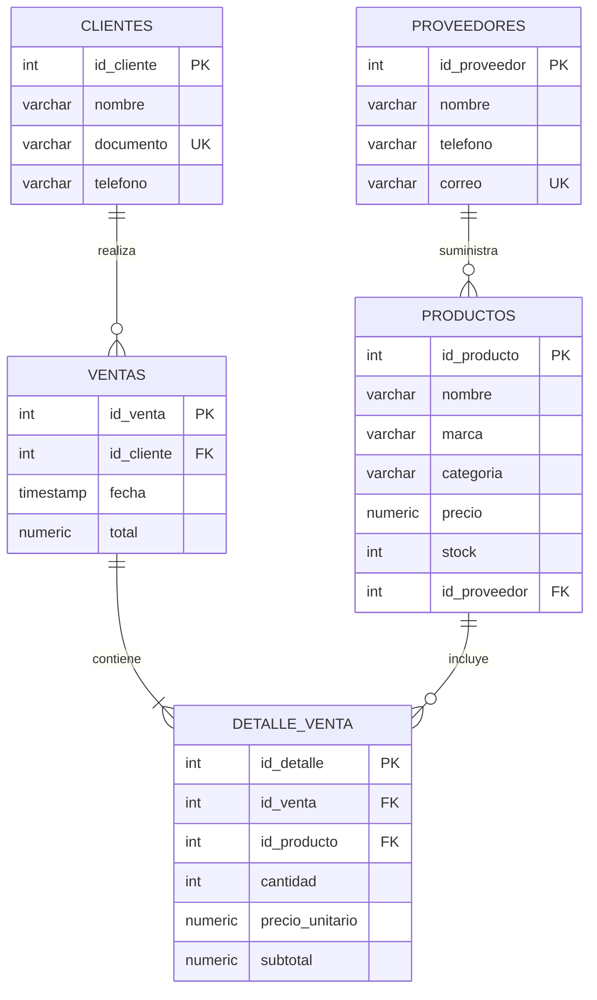

# Diagrama entidad-relación

Sistema para Venta de Computadoras.

GitHub dibuja el diagrama Mermaid al abrir este archivo. Las cardinalidades usan la notación de pata de gallo:

| Símbolo | Significado |
| --- | --- |
| `\|\|` | Exactamente uno |
| `o{` | Cero o muchos |
| `\|{` | Uno o muchos |

## Lectura de las cardinalidades

- Un proveedor suministra cero o muchos productos. Cada producto tiene un proveedor.
- Un cliente realiza cero o muchas ventas. Cada venta tiene un cliente.
- Una venta contiene uno o muchos detalles. Cada detalle pertenece a una venta.
- Un producto se incluye en cero o muchos detalles. Cada detalle referencia un producto.

La obligación de que una venta tenga al menos un detalle es una regla del modelo conceptual y de la API. La clave foránea, por sí sola, no puede impedir una cabecera de venta vacía durante el instante en que la transacción todavía no inserta las líneas. Esa decisión se explica en [modelo_fisico.md](modelo_fisico.md).

Los tipos del diagrama son orientativos. Los tipos SQL exactos, con precisión y restricciones, están en [diccionario_datos.md](diccionario_datos.md) y en `database/01_ddl.sql`.
